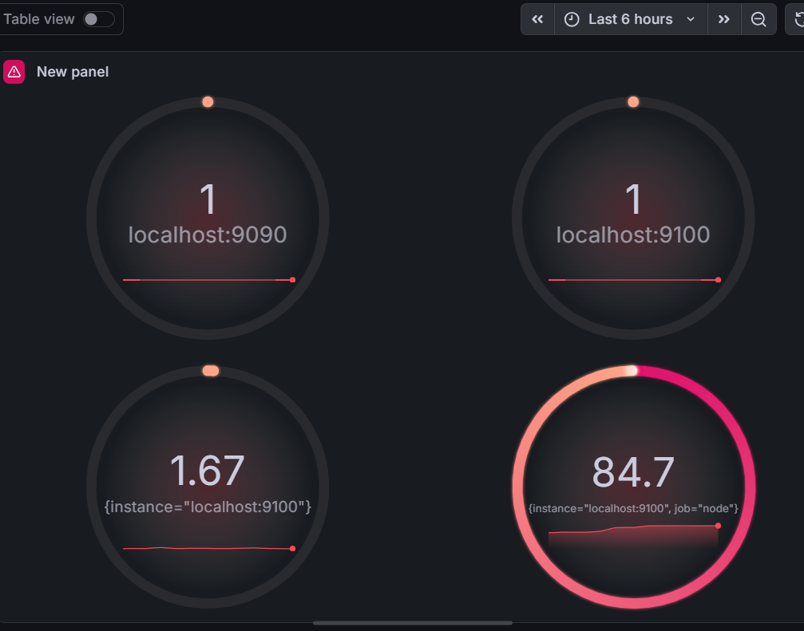
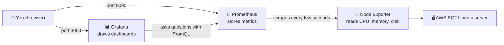
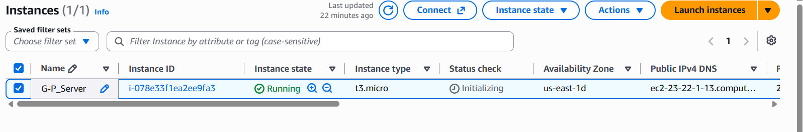
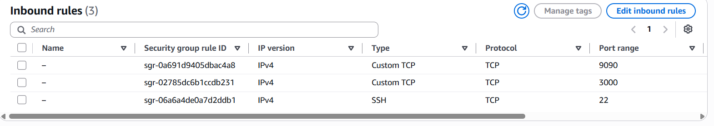
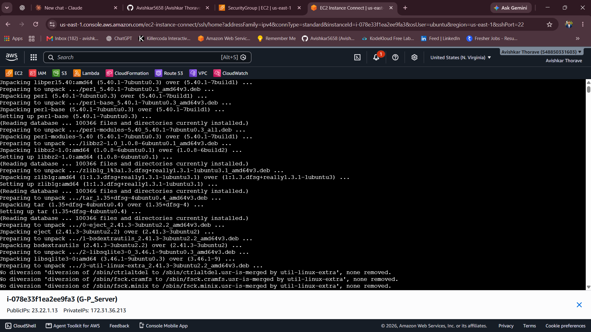
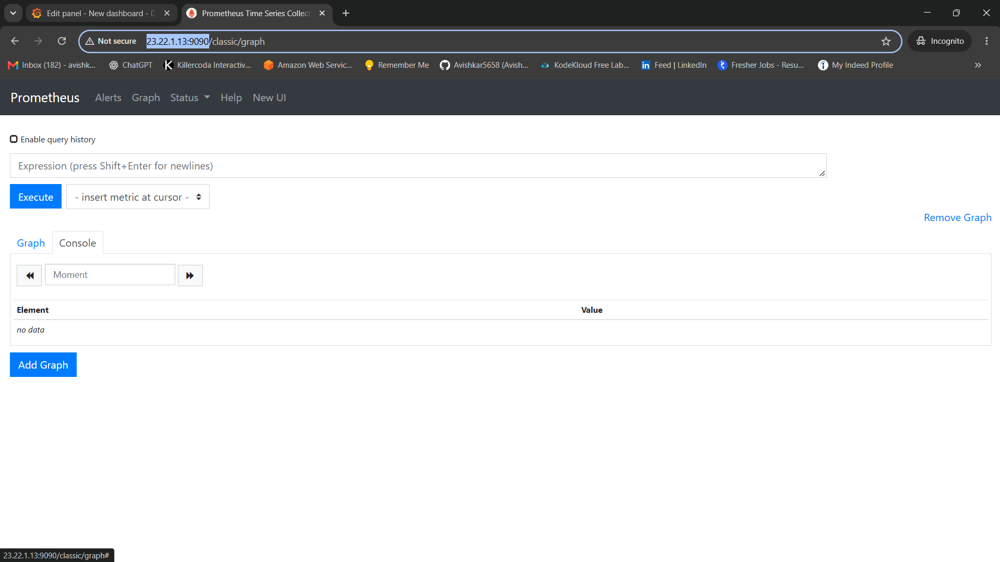
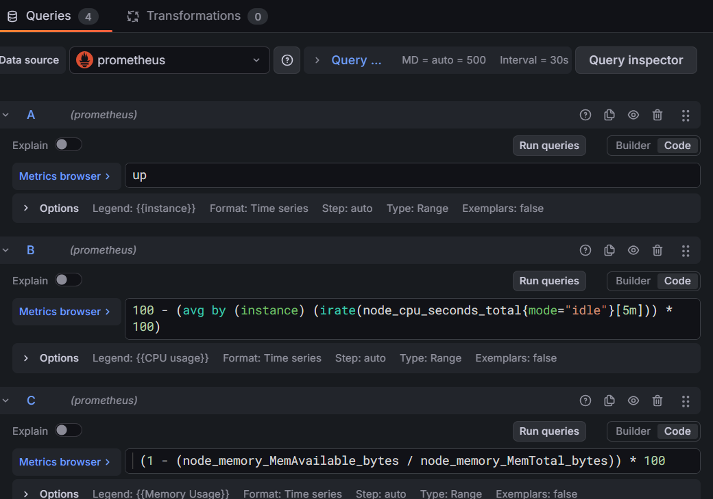

<div align="center">

# 📊 Monitor an AWS Server with Prometheus & Grafana

### See problems **before your users do**: live CPU, memory and uptime dashboards in about 30 minutes.


<br>



<sub>👆 <b>The result:</b> a live dashboard showing that the services are up (1 = healthy), CPU usage (%) and memory usage (%) of a real cloud server.</sub>

</div>

---

## 📑 Table of Contents

1. [The Problem](#-the-problem-in-plain-english)
2. [The Solution](#-the-solution)
3. [Architecture](#-architecture)
4. [Tools Used and Why](#-tools-used-and-why)
5. [What You Will Build](#-what-you-will-build)
6. [Step-by-Step Implementation](#-step-by-step-implementation)
7. [Dashboard Queries (PromQL)](#-dashboard-queries-promql)
8. [Troubleshooting](#-troubleshooting)
9. [Security Notes](#-security-notes)
10. [Challenges and What I Learned](#-challenges-and-what-i-learned)
11. [Cost Note and Cleanup](#-cost-note-and-cleanup)
12. [Future Improvements](#-future-improvements)
13. [Use This Project](#-use-this-project-in-your-own-repo)

---

## 🤔 The Problem 

Imagine an online shop running on a computer in the cloud (a **server**).

**Without monitoring:**

- 😟 The server's disk fills up and the website crashes, and nobody notices
- 😟 Customers are the first to find out something is wrong
- 😟 The team wastes hours working out *what* broke and *when*

Like driving a car with no dashboard: you only learn about the problem when the engine stops.

## 💡 The Solution

This project shows **how to add a "dashboard" to a cloud server** using two free, industry-standard tools: **Prometheus** and **Grafana**.

> 🚗 **Car analogy**
>
> - **Node Exporter** = the *sensors* in the engine (they measure CPU, memory, disk)
> - **Prometheus** = the *logbook* (it records the readings every few seconds)
> - **Grafana** = the *dashboard* you look at while driving (speedometer, fuel gauge, warning lights)

| Term | Simple meaning |
|------|----------------|
| 🖥️ **Server (EC2)** | A computer you rent from Amazon in the cloud |
| 📏 **Metric** | A number that describes health, like "CPU is 2% busy" |
| 🔌 **Node Exporter** | A small helper that reads the server's numbers |
| 📒 **Prometheus** | Collects and stores those numbers over time |
| 📊 **Grafana** | Turns the numbers into charts and gauges |
| 🔍 **PromQL** | The question language used to ask Prometheus for data |

### ✅ Result

A **live monitoring dashboard** that shows whether the server is up and how much CPU and memory it uses, so problems can be spotted early.

---

## 🏗️ Architecture



**How to read the diagram (follow the arrows):**

1. 🔌 **Node Exporter** reads the server's numbers (CPU, memory, disk) and publishes them on port **9100**.
2. 📒 **Prometheus** "scrapes" (reads) those numbers every few seconds and saves them with a timestamp.
3. 📊 **Grafana** asks Prometheus questions and draws the answers as gauges and graphs.
4. 👤 **You** open Grafana in a browser and see the live dashboard.

All three tools run on the **same EC2 server**, which keeps the setup simple.

---

## 🧰 Tools Used and Why

| Tool | What it is (simple) | Why it's used here | Port |
|------|---------------------|--------------------|:----:|
| **AWS EC2** (`t3.micro`) | A virtual computer in the cloud | The server being monitored | 22 |
| **Ubuntu Server** | A popular Linux operating system | Runs all the tools | n/a |
| **Node Exporter** | The server's "sensors" | Reads CPU, memory and disk numbers | 9100 |
| **Prometheus** | The "logbook" | Scrapes, stores and queries the numbers | 9090 |
| **Grafana** | The "dashboard" | Draws the numbers as gauges and graphs | 3000 |
| **Security Group** | A virtual firewall | Decides which ports the internet can reach | n/a |

---

## 🎯 What You Will Build

- ✅ One **EC2 instance** (Ubuntu, `t3.micro`) with ports **22, 9090 and 3000** open
- ✅ **Prometheus + Node Exporter** collecting server metrics
- ✅ **Grafana** showing those metrics on a live dashboard

⏱️ **Time needed:** about 30 minutes. 🎓 **Experience needed:** none. Every command can be copied and pasted.

---

## 🛠️ Step-by-Step Implementation

> 🌎 **Region used:** US East (N. Virginia), `us-east-1`

### ✅ Prerequisites

- An [AWS account](https://aws.amazon.com/free/)
- Basic comfort with copy-pasting commands into a terminal

---

### Step 0️⃣ — Launch the EC2 server and open the ports

**1. Launch the instance** in the EC2 console:

| Setting | Value used here |
|---------|-----------------|
| Name | `G-P_Server` |
| AMI | Ubuntu Server |
| Instance type | `t3.micro` |
| Region | `us-east-1` (N. Virginia) |

Wait until **Instance state** shows **Running** and **Status check** shows **2/2 passed**.

<div align="center">
  
</div>

**2. Add inbound rules** to the instance's security group (*Security* tab → *Edit inbound rules*):

| Type | Port | Used for |
|------|:----:|----------|
| SSH | 22 | Logging in to the server |
| Custom TCP | 3000 | Grafana website |
| Custom TCP | 9090 | Prometheus website |

<div align="center">
  
</div>

> 🔒 Without these rules your browser cannot reach Grafana or Prometheus.

---

### Step 1️⃣ — Connect to the server

Use **EC2 Instance Connect** to open a terminal in your browser. No key file is needed.

1. In the EC2 console, select the instance and click **Connect**
2. Open the **EC2 Instance Connect** tab, keep the username `ubuntu`, and click **Connect**
3. A terminal opens. Every command below is typed here.

<div align="center">
  
</div>

📝 Note the **Public IP** shown under the terminal. You need it in Step 4.

---

### Step 2️⃣ — Install Prometheus and Node Exporter

**2.1 Update the system:**

```bash
sudo apt update
sudo apt upgrade -y
```

**2.2 Install both tools:**

```bash
sudo apt install prometheus prometheus-node-exporter -y
```

**2.3 Start them and make them start automatically after a reboot:**

```bash
sudo systemctl enable --now prometheus prometheus-node-exporter
```

**2.4 Check that they are running:**

```bash
systemctl status prometheus
systemctl status prometheus-node-exporter
```

✅ You should see **`active (running)`** in green. Press `q` to leave the status screen.

---

### Step 3️⃣ — Install Grafana

Grafana is not in Ubuntu's default package list, so first add Grafana's official repository.

**3.1 Install helper packages and add Grafana's signing key** (lets Ubuntu verify the download is genuine):

```bash
sudo apt-get install -y apt-transport-https wget gnupg
sudo mkdir -p /etc/apt/keyrings
sudo wget -O /etc/apt/keyrings/grafana.asc https://apt.grafana.com/gpg-full.key
sudo chmod 644 /etc/apt/keyrings/grafana.asc
```

**3.2 Add the Grafana repository (stable releases):**

```bash
echo "deb [signed-by=/etc/apt/keyrings/grafana.asc] https://apt.grafana.com stable main" | sudo tee -a /etc/apt/sources.list.d/grafana.list
```

**3.3 Install Grafana:**

```bash
sudo apt-get update
sudo apt-get install -y grafana
```

**3.4 Start Grafana and enable it at boot:**

```bash
sudo systemctl daemon-reload
sudo systemctl start grafana-server
sudo systemctl enable grafana-server
```

**3.5 Verify it is running:**

```bash
sudo systemctl status grafana-server
```

✅ Look for **`active (running)`**, then press `q`.

---

### Step 4️⃣ — Open Prometheus and Grafana in your browser

Replace `<Public-IP>` with the Public IPv4 address from the EC2 console. Use plain **`http`**, not https.

| Tool | Address | Login |
|------|---------|-------|
| 📒 Prometheus | `http://<Public-IP>:9090` | None |
| 📊 Grafana | `http://<Public-IP>:3000` | `admin` / `admin` (you must set a new password on first login) |

**Test Prometheus:** type `up` in the Expression box and click **Execute**. A value of **1** means a target is healthy; **0** means it is down.

<div align="center">
  
</div>

---

### Step 5️⃣ — Connect Grafana to Prometheus and build the dashboard

**5.1 Log in** to Grafana and set a new password when asked.

**5.2 Add Prometheus as a data source**

1. Left menu → **Connections** → **Data sources** → **Add data source**
2. Choose **Prometheus**
3. Set the URL to `http://localhost:9090` (both run on the same server)
4. Click **Save & test**. A green *"Successfully queried the Prometheus API"* message means it works ✅

**5.3 Create a dashboard panel**

1. **Dashboards** → **New** → **New dashboard** → **Add visualization**
2. Select the **prometheus** data source
3. Switch each query box from **Builder** to **Code** and paste the queries from the [next section](#-dashboard-queries-promql), one query per box (A, B, C…)

<div align="center">
  
</div>

> 💡 **Tip:** in each query's *Options*, set **Legend** to custom text like `CPU usage` so the panel shows a readable name.

**5.4 Pick the visualization:** choose **Gauge** (or *Stat* / *Time series*), give the panel a title, then click **Save dashboard**. 🎉

---

## 📈 Dashboard Queries (PromQL)

| Query | What it shows | PromQL |
|:-----:|---------------|--------|
| **A** | Is everything up? (1 = yes, 0 = down) | `up` |
| **B** | CPU usage % | `100 - (avg by (instance) (irate(node_cpu_seconds_total{mode="idle"}[5m])) * 100)` |
| **C** | Memory usage % | `(1 - (node_memory_MemAvailable_bytes / node_memory_MemTotal_bytes)) * 100` |
| **D** *(optional)* | Disk usage % of the root drive | `100 - ((node_filesystem_avail_bytes{mountpoint="/",fstype!~"tmpfs\|squashfs"} / node_filesystem_size_bytes{mountpoint="/",fstype!~"tmpfs\|squashfs"}) * 100)` |

> ℹ️ In the disk query, use `!~` (not equal to the pattern), not `!`. When copying from the table, change `\|` back to `|`.

### 🖼️ What the finished dashboard shows

- **1 and 1:** Prometheus (`localhost:9090`) and Node Exporter (`localhost:9100`) are both **up**
- **1.67:** CPU usage in percent
- **84.7:** memory usage in percent

---

## 🩺 Troubleshooting

Most problems come from a closed port or a stopped service.

| Problem | Likely cause | Fix |
|---------|--------------|-----|
| Grafana or Prometheus page does not open | Port 3000 or 9090 not allowed in the security group | Add the inbound rule ([Step 0](#step-0️⃣--launch-the-ec2-server-and-open-the-ports)) |
| Page still does not open | Using `https`, or the Public IP changed after a stop/start | Use `http://<Public-IP>:port` with the current IP |
| `up` shows 0 or "no data" | A service stopped | `sudo systemctl status prometheus`, then `sudo systemctl restart <name>` |
| Grafana data source error | Wrong URL | Use `http://localhost:9090` |
| Disk query shows an error | Filter typed as `!` instead of `!~` | Use the corrected query above |
| Cannot connect from the browser to EC2 | Port 22 closed | Add the SSH rule |

---

## 🔐 Security Notes

This project is for **learning**. Before using anything like it for real, harden it:

- 🔒 Set the source of **port 22** to **My IP** instead of `0.0.0.0/0`
- 🔒 Restrict ports **9090** and **3000** to your IP too. Prometheus has no login by default.
- 🔑 **Change Grafana's default password** (`admin`/`admin`) immediately
- 🌐 Add **HTTPS** before exposing Grafana to the public internet

---

## 🎓 Challenges and What I Learned

> ✏️ *Replace the rows below with problems you actually faced. Genuine lessons stand out the most.*

| Challenge | How I solved it |
|-----------|-----------------|
| Browser could not open Grafana at first | Added the missing inbound rule for port 3000 in the security group |
| Page would not load over `https` | Used plain `http://<Public-IP>:3000` |
| Disk usage query failed | Fixed the filter from `!` to `!~` |

**Key takeaways**

- ✅ Prometheus **collects and stores** metrics, Node Exporter **supplies** them, Grafana **draws** them
- ✅ The ports to remember: **9090** (Prometheus), **9100** (Node Exporter), **3000** (Grafana)
- ✅ How to read **PromQL** queries for CPU, memory, disk and up-status
- ✅ Why monitoring means you **see problems before users do**

---

## 💰 Cost Note and Cleanup

A running EC2 instance can cost money once it is outside the AWS Free Tier limits. Check current terms on the [AWS Free Tier page](https://aws.amazon.com/free/).

### 🧹 Clean up when you finish practising

1. In the EC2 console, select the instance
2. **Instance state** → **Terminate instance**
3. Delete the security group if you no longer need it

> ⚠️ A stopped or running instance can still incur costs, and a stop/start **changes the Public IP**. Check the AWS Billing dashboard after cleanup.

---

## 🔮 Future Improvements

- [ ] 🔔 Add **Alertmanager** to send alerts by email or Slack
- [ ] 🖥️ Monitor **multiple servers** with one Prometheus
- [ ] 🐳 Run the stack with **Docker Compose**
- [ ] 🏗️ Automate the whole setup with **Terraform**
- [ ] 📥 Import a ready-made **Node Exporter dashboard** in Grafana
- [ ] 🔐 Add **HTTPS** and authentication

---

## 🔁 Use This Project in Your Own Repo

Want to try it or add it to your own portfolio?

1. **Fork** this repository (top-right button) or download it as a ZIP
2. Follow the [step-by-step guide](#-step-by-step-implementation) in your own AWS account
3. Replace the screenshots in `screenshots/` with **your own**
4. Add your own dashboard panels (disk, network, uptime…)
5. Write your own **Challenges and What I Learned** section
6. ⭐ If it helped you, give the repo a star!

### 📁 Repository structure

```
aws-ec2-monitoring-prometheus-grafana/
├── README.md
└── screenshots/
    ├── grafana-dashboard.png
    ├── ec2-running.png
    ├── security-group-rules.png
    ├── ec2-connect-terminal.png
    ├── prometheus-ui.png
    └── grafana-panel-editor.png
```

---

## 👤 Author

**Avishkar Thorave**

[](https://github.com/Avishkar5658)
[](https://www.linkedin.com/in/avishkar-thorve-a77a8b2a1)

---

<div align="center">

⭐ **If you found this useful, give it a star!** ⭐

*Built with ☁️ AWS and a lot of curiosity.*

</div>
